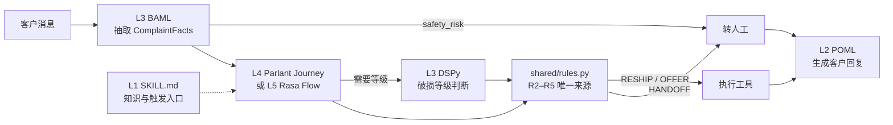

# SkillStrata

> 同一个客服场景，五层语义化编程：从一句自然语言，到一步不差的确定性执行。
>
> One customer-service scenario, five strata of semantic programming — from plain-language skills to deterministic flows.

AI Agent 的“技能”可以写成一段 Markdown，也可以写成一条状态机。两者之间还有结构化提示、类型化语义函数、条件—动作规则等多种写法。SkillStrata 用**同一个售后场景、同一组业务规则、同一组测试用例**，把这五层分别实现一遍，让差异一目了然：

**哪些判断该交给模型，哪些必须由代码保证？**

## 场景

海外客户反馈“大件户外家具到货破损或缺件”。8 条示意规则覆盖信息收集、30 天时限、配件库存、破损分级、审批阈值、安全拦截和话术约束，详见 [policy.md](layer1-agent-skill/damaged-or-missing-parts/references/policy.md)。

> 所有规则、金额、订单号、配件号均为示意数据，不代表任何真实企业的售后政策。

## 五层一览

| 层 | 方案 | 目录 | 在本场景中负责 | 确定性 |
|---|---|---|---|---|
| 1 | [Agent Skills](https://agentskills.io/specification)（SKILL.md） | [`layer1-agent-skill/`](layer1-agent-skill/) | 触发条件、处理步骤；硬规则下沉到脚本 | 低 |
| 2 | [POML](https://github.com/microsoft/poml) | [`layer2-poml/`](layer2-poml/) | 生成客户回复，只使用规则返回的方案 | 低到中 |
| 3 | [BAML](https://docs.boundaryml.com/) + [DSPy](https://dspy.ai/) | [`layer3-typed-functions/`](layer3-typed-functions/) | BAML 抽取强类型事实；DSPy 判断破损等级并用历史工单优化 | 中 |
| 4 | [Parlant](https://www.parlant.io/) | [`layer4-parlant/`](layer4-parlant/) | 自适应多轮 SOP；安全规则任何时刻生效 | 中到高 |
| 5 | [Rasa CALM](https://rasa.com/docs/reference/primitives/flows) | [`layer5-rasa/`](layer5-rasa/) | 确定性流程；关键槽位只能由代码写入 | 高 |

所有层共用 [`shared/rules.py`](shared/rules.py) 作为业务结论的**唯一事实来源**。

## 架构



## 六个用例在各层的表现

| 用例 | L1 SKILL.md | L2 POML | L3 BAML/DSPy | L4 Parlant | L5 Rasa |
|---|---|---|---|---|---|
| T1 缺件有库存 | 模型调脚本 → 补寄 | 补寄话术 | 抽出 C4 | 走缺件分支 | ask_parts → 补寄 |
| T2 轻微划痕 | 判 COSMETIC → 两个选项 | 并列两个选项 | 判 COSMETIC | 呈现选项等待选择 | ask_choice |
| T3 结构破损 > 300 USD | 脚本返回 HANDOFF | 转人工话术 | 判 STRUCTURAL | 转人工 | 转人工 |
| T4 受伤 + 律师 | **依赖模型自觉** | 安全专用写法 | safety_risk=true | **全局规则随时拦截** | **首步硬拦截** |
| T5 信息不全 | **依赖模型追问** | — | order_id=null 可断言 | 停在追问状态 | **collect 强制追问** |
| T6 超 30 天 | 脚本返回 HANDOFF | 转人工话术 | — | 超期分支 | 条件分支转人工 |

差异集中在 T4、T5：**越往下层，“必须做”的事越由运行时保证，而不是靠模型自觉。**

## 快速开始

规则层可以直接运行：

```bash
pip install pytest
python -m pytest -q tests

python layer1-agent-skill/damaged-or-missing-parts/scripts/decide.py \
  --order-id AS-10088 --issue DAMAGED --severity COSMETIC
# {"decision": "OFFER", "options": ["RESHIP_PARTS", "PARTIAL_REFUND_15"]}
```

其余各层是按官方文档语法编写的参考实现，外部系统（OMS、库存、工单、转人工）用桩函数表示，需要按所用版本和实际接口接入后再运行。

## 目录结构

```text
skill-strata/
├── shared/rules.py                      # 业务结论唯一来源（R2–R5）
├── layer1-agent-skill/damaged-or-missing-parts/
│   ├── SKILL.md
│   ├── references/{policy.md, reply-templates.md}
│   └── scripts/decide.py
├── layer2-poml/{reply.poml, render.py}
├── layer3-typed-functions/
│   ├── baml_src/complaint.baml          # 事实抽取 + @@assert 测试
│   └── dspy/assess_damage.py            # 破损等级判断 + 代价敏感指标
├── layer4-parlant/agent.py              # Journey + 全局 Guideline + 工具
├── layer5-rasa/
│   ├── data/flows.yml
│   ├── domain.yml
│   └── actions/actions.py
├── tests/{test_rules.py, cases.yaml}
└── docs/walkthrough.md                  # 完整讲解文档
```

## 规则归属原则

| 规则类型 | 放在哪里 |
|---|---|
| 纯计算（时限、阈值、库存） | `shared/rules.py`，只写一次 |
| 需要语义判断（破损等级、安全风险识别） | L3，配标注样本和指标 |
| 必须发生的步骤（追问、安全拦截） | L4 或 L5，由运行时保证 |
| 话术与语气 | L2，话术团队维护 |

完整讲解见 [docs/walkthrough.md](docs/walkthrough.md)。

## License

MIT
