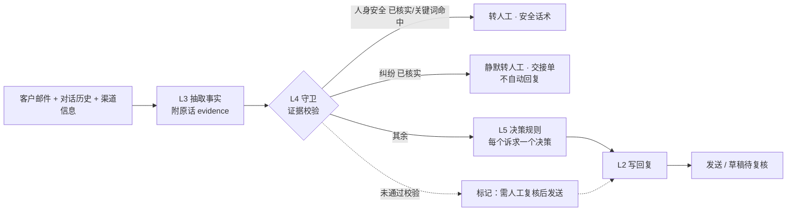

# 客服 Skill 分层内容（基于 24 个基线用例）

> 版本：SkillStrata Bench v8（2026-11-11）。
> 来源：[skill-strata/demo](https://github.com/iamharvey/skill-strata/tree/main/demo) 中的 `core/prompts.js`、`core/rules.js`、`core/data.js`、`core/cases.js`。
> 订单、商品、政策都是示意数据。规则类内容（L4 守卫、L5 决策）见配套文件《客服Skill规则伪代码.md》。

## 0. 总览

| 层 | 名称 | 由谁执行 | 负责什么 | 不负责什么 | 本文位置 |
|---|---|---|---|---|---|
| L1 | Skill 入口（SKILL.md） | Agent 运行时 | 什么时候触发、处理顺序、边界、交付物 | 业务结论 | 第 1 节 |
| L2 | 回复生成 | 模型 | 把决策写成客户语言的邮件 | 决定给什么方案、金额、日期 | 第 4 节 |
| L3 | 事实抽取 | 模型 | 把邮件和对话历史变成结构化事实，高影响字段附原话 | 做判断、写回复 | 第 2 节 |
| L4 | 守卫与校验 | 代码（确定性） | 安全/纠纷证据校验、关键词兜底、人工复核标记 | 写回复 | 规则伪代码 §2 |
| L5 | 决策规则 | 代码（确定性） | 订单解析、SKU 兜底、按意图给出唯一决策、多轮状态、交接单 | 写回复 | 规则伪代码 §3–§8 |

处理流水线：



设计原则：

1. 模型只做两件事：读懂客户（L3）和把结论说清楚（L2）。
2. 能给什么方案、多少钱、几天，由 L5 规则唯一决定；L2 不能新增。
3. 高影响判断（人身安全、纠纷）不直接相信模型：L3 必须给出客户原话，L4 用代码核对。
4. 拿不准时宁可交给人：校验不通过就转为草稿待复核；抽取失败就整单转人工。

---

## 1. L1 · Skill 入口（SKILL.md）

```markdown
---
name: after-sales-email
description: >
  处理跨境户外家具品牌的售后、退换货、产品问答和物流查询邮件（含 eBay/Amazon 站内信与多轮对话）。
  当收到客户邮件或平台消息、需要给出处理方案并回复时使用。
  不用于：营销邮件、供应商沟通、内部工单。
---

# 售后邮件 Skill

## 什么时候用
- 客户来信涉及：缺件、到货破损、使用中故障、退货、换色、产品规格问题、发货/到货时间、签收未收到、改地址。
- 一封邮件可能有多个诉求，或是之前对话的续篇（附带我方已发出的回复）。

## 处理顺序（必须按顺序，不得跳步）
1. 调用 L3 抽取：得到结构化事实（facts），包括每个诉求的 intents、人身安全/纠纷标记及客户原话。
2. 调用 L4 守卫：核对原话。人身安全成立 → 转人工；纠纷成立 → 静默转人工（不自动回复）。
3. 调用 L5 规则：对每个诉求得到唯一决策（decision）和可用的选项、金额、事实。
4. 若所有决策都是“不自动回复” → 生成交接单，结束。
5. 否则调用 L2 回复：只用第 3 步给出的内容写邮件。
6. 若任一决策带 review_required → 回复作为草稿，等人工复核后发送。

## 硬边界
- 不自行决定退款比例、金额、日期、时效；只用规则返回的值。
- 人身伤害、律师、媒体：只道歉并转专人，不谈原因、责任、赔偿。
- 拒付、平台投诉、差评威胁：不自动回复，转人工接管。
- 不向客户描述内部流程（质量团队、缺陷登记、找开发核对、生产批次、QC）。
- 不承诺无法保证的事（例如“换一个批次的货”）。
- 不要求客户自己修理或自己找人修理。

## 交付物
- 决策列表（每个诉求一条）+ 客户回复（或空，表示不自动回复）。
- 转人工时：交接单（客户诉求、案件事实、按政策应得的处理、优先级）。
- 需复核时：复核原因列表。

## 参考
- references/policy.md：售后政策 19 条（见本文附录 A）
- references/extract.md：L3 抽取规范（本文第 2 节）
- references/reply.md：L2 回复规范（本文第 4 节）
- scripts/rules：L4/L5 规则实现（见《客服Skill规则伪代码.md》）
```

---

## 2. L3 · 事实抽取（模型）

### 2.1 职责

只抽取客户实际说过的内容，不做判断，不写回复。输出必须是 JSON。

### 2.2 输出结构

| 字段 | 类型 | 说明 | 由哪层使用 |
|---|---|---|---|
| language | ISO 639-1 | 客户语言 | L2 |
| safety_risk | bool | 人或动物已受伤，或提到人身危险、律师、诉讼、媒体 | L4 |
| animal_safety | bool | 宠物笼具损坏、动物可能逃出或受伤（尚未受伤） | L5 |
| dispute | bool | 提到/威胁拒付、支付争议、平台投诉（eBay/Amazon）、差评 | L4 |
| dispute_type | CHARGEBACK / MARKETPLACE_CASE / FEEDBACK / null | 纠纷类型 | L5 交接单 |
| evidence.safety_risk | string / null | safety_risk 为 true 时，逐字摘录客户原话 | L4 校验 |
| evidence.dispute | string / null | dispute 为 true 时，逐字摘录客户原话 | L4 校验 |
| previous_offers[] | 对象数组 | 我方此前给过的方案：type、pct、units、status（PENDING/ACCEPTED/REJECTED）、reject_reason | L5 多轮状态 |
| customer_choice | REPLACEMENT / FULL_REFUND / PARTIAL_REFUND / null | 客户当前明确要求的处理 | L5 多轮状态 |
| info_already_given[] | string 数组 | 客户在对话中已经提供的信息 | L2（避免重复追问） |
| intents[] | 对象数组 | 每个诉求、每个不同问题一条（见下表） | L5 |

intents 每一项：

| 字段 | 取值 | 说明 |
|---|---|---|
| type | DAMAGE / MISSING_PARTS / DEFECT_WARRANTY / RETURN / EXCHANGE / PRODUCT_QA / SHIPPING_STATUS / NOT_RECEIVED / ADDRESS_CHANGE / OTHER | 诉求类型 |
| order_id | 邮件中写明的订单号，否则 null | 不得编造；商品刊登号不是订单号 |
| sku | 能按名称对上目录的 SKU，否则 null | L5 有兜底匹配 |
| part_codes[] | 说明书配件号，如 C4 | 缺件用 |
| severity | COSMETIC / STRUCTURAL / UNKNOWN | 破损与故障用 |
| component | 出问题的部件，如 front mesh door | 多问题拆分用 |
| repeat_issue | bool | 客户说是第 2 件（或更多）出同样问题 |
| units_affected | int，默认 1 | 这个部件这个问题涉及几件 |
| item_condition | UNOPENED / UNASSEMBLED / ASSEMBLED / USED / UNKNOWN | 退换货用 |
| reason | CHANGED_MIND / DEFECT / OTHER | 退货原因 |
| target_variant | 小写颜色/款式，否则 null | 换货用 |
| qa_topics[] | MAX_LOAD / DIMENSIONS / MATERIAL / WEATHER / ASSEMBLY / CARE / CERTIFICATION / BATTERY / AGE_RANGE / WARRANTY | 产品问答涉及的主题 |
| has_photo / has_video | bool | 只有该问题本身有照片/视频时才为 true |
| customer_demand | 简短文本，否则 null | 客户明确提出的要求 |

### 2.3 判定口径（写进提示词）

- DAMAGE：到货即破损（划痕、凹陷、到货或组装时断裂）。MISSING_PARTS：箱内缺件。DEFECT_WARRANTY：用过一段时间后出故障。
- RETURN：退货退款。EXCHANGE：换颜色或款式。
- PRODUCT_QA：规格或适用性问题；每个商品一条，列出所有被问到的主题。
- SHIPPING_STATUS：订单在哪、何时发货或到货。NOT_RECEIVED：显示签收但没收到。ADDRESS_CHANGE：改收货地址。
- 一个诉求一条 intent；不同部件或不同缺陷（例如网片断裂和托盘生锈）分开，各自填 units_affected 和 has_photo。
- 严重程度：STRUCTURAL = 断裂、开裂、变形、无法组装，网片/焊点/铰链/锁扣失效导致无法使用；COSMETIC = 只有划痕、凹陷、色差。
- 宠物笼具损坏、动物可能逃出，但没有人或动物受伤：是 animal_safety，不是 safety_risk。
- 多轮对话要读完整个往来：从我方历史回复和客户反应中填写 previous_offers，描述案件当前状态。

### 2.4 提示词（v8 实测版，英文原文）

```text
You extract structured facts from a customer service email. Do NOT decide outcomes, do NOT write a reply.
Extract only what the customer actually says. Return JSON only, matching the schema.

- safety_risk: true if a person or animal has been injured, or a safety hazard to people, lawyer, lawsuit or media is mentioned.
- animal_safety: true if a pet/animal enclosure is damaged so animals could escape or get hurt (no injury yet).
- dispute: true if a chargeback, payment dispute, marketplace case (eBay/Amazon) or negative feedback is mentioned, filed or threatened.
- evidence.safety_risk / evidence.dispute: if the flag is true, the customer's exact words (copied verbatim); else null.
- order_id: order number written in the email, else null. Do not invent; listing/item numbers are not order numbers.
- sku: catalog SKU if the product can be identified by name, else null.

Create one intent per distinct request, and one intent per distinct problem: different components or different
defects are separate intents, each with its own units_affected and has_photo (has_photo is true only if a photo
of THAT problem was sent anywhere in the thread).
A damaged pet enclosure where animals could escape but no one (person or animal) has been hurt is animal_safety, NOT safety_risk.
If the email contains earlier messages, read the whole thread: fill previous_offers from our team's earlier
replies and the customer's reactions; describe the current state of the case.

Product catalog (names only): <SKU: name 列表>
```

输入：发件人、渠道（平台/买家/商品号）、主题、附件列表、历史往来（标明哪些是我方已发出的回复）、本轮客户消息、附件图片描述。

### 2.5 抽取示例（C24，claude_haiku_5_5 v8 实际输出，节选）

```json
{
  "language": "en",
  "safety_risk": false,
  "animal_safety": true,
  "dispute": true,
  "dispute_type": "MARKETPLACE_CASE",
  "evidence": { "safety_risk": null, "dispute": "I will be going.to ebay them.self if this doesn't get sorted ASAP" },
  "previous_offers": [
    { "type": "PARTIAL_REFUND", "pct": 15, "units": 1, "status": "REJECTED" },
    { "type": "PARTIAL_REFUND", "pct": 30, "units": 1, "status": "REJECTED" },
    { "type": "REPLACEMENT_WITH_COLLECTION", "status": "REJECTED", "reject_reason": "nowhere to keep ferrets while waiting" },
    { "type": "REPLACEMENT_NO_RETURN", "units": 1, "status": "REJECTED", "reject_reason": "wants all 3 replaced" }
  ],
  "customer_choice": "REPLACEMENT",
  "intents": [
    { "type": "DEFECT_WARRANTY", "sku": "D51-105V01", "severity": "STRUCTURAL", "component": "front mesh door",
      "repeat_issue": true, "units_affected": 2, "has_photo": true, "customer_demand": "Replacement of all 3 cages" },
    { "type": "DEFECT_WARRANTY", "sku": "D51-105V01", "component": "metal tray",
      "units_affected": 3, "customer_demand": "Replacement of all 3 cages" }
  ]
}
```

L4 核对：dispute 的原话出现在客户本轮消息中，且命中纠纷词表（ebay）→ 纠纷成立 → 静默转人工，交接单写明“网片 2 件（重复）、托盘 3 件、客户要求全部更换、笼具先发、宠物安全提醒”。

---

## 3. L4 / L5 · 规则层（代码）

规则层不调用模型，相同输入永远得到相同输出。完整伪代码见《客服Skill规则伪代码.md》，要点：

| 规则组 | 作用 | 对应用例 |
|---|---|---|
| L4 证据校验 | safety_risk / dispute 必须有客户原话，且原话命中人身风险或纠纷词表；否则不走高影响分支，并要求人工复核 | C03、C04、C24；挡住 nano 在 C21–C23 的误判 |
| L4 关键词兜底 | 最新邮件出现受伤、急诊、律师等词时，即使模型漏判也转人工 | C04 |
| L5 订单解析 | 先用邮件里写的订单号；平台消息按“平台 + 买家 + 商品号”关联订单 | C21–C24 |
| L5 SKU 兜底 | 模型没给出有效 SKU 时，按客户原文的商品名或 SKU 编号匹配，唯一命中才用 | C11–C15、C20 |
| L5 QA 判定 | 规格有就答；没有且客户确实问到 → 答不了；没问到 → 忽略多标的主题 | C11–C15、C20 |
| L5 意图决策 | 缺件、破损、保修、退货、换货、物流、签收未收到、改地址，各有固定分支 | C01–C20 |
| L5 重复缺陷 | 第 2 件起同类结构性故障：不给配件或部分退款，只给“更换或全额退款”；笼具先发新品 | C21–C24 |
| L5 多轮状态 | 不重复客户拒绝过的方案；客户已选择则直接确认；纠正“让客户自己修” | C22–C24 |
| L5 纠纷交接单 | 纠纷成立时整单静默转人工，并整理客户诉求、案件事实、应得处理 | C03、C24 |

决策词表（L5 只能输出这些值，L2 只能按这些值写）：

`RESHIP_PARTS` `OFFER_PARTS_OR_PARTIAL_REFUND` `OFFER_REPLACEMENT_OR_REFUND` `HANDOFF` `WARRANTY_PARTS` `OUT_OF_WARRANTY` `RETURN_ALLOWED` `DECLINE_RETURN` `EXCHANGE` `ANSWER_QA` `QA_UNKNOWN` `SHIPPING_DELAY_ESCALATE` `CARRIER_INVESTIGATION` `WAIT_48H` `PROVIDE_ETA` `ADDRESS_CHANGE_OK` `ADDRESS_CHANGE_DENIED` `ASK_INFO` `QUALITY_ESCALATION`

---

## 4. L2 · 回复生成（模型）

### 4.1 职责

用客户的语言写一封邮件，覆盖每一条决策：先用一句话确认问题，再逐条给出处理结果，最后说明下一步。只能使用规则给出的决策、选项、金额、日期和商品事实。

### 4.2 每种决策的写法

| 决策 | 怎么写 | 不能写 |
|---|---|---|
| RESHIP_PARTS | 确认配件号；运单号随后邮件发送 | 发货日期 |
| OFFER_PARTS_OR_PARTIAL_REFUND | 并列两个选项（换配件 / 15% 部分退款），请客户选；客户要求其他比例时，礼貌说明可选项就是这些 | 其他比例 |
| OFFER_REPLACEMENT_OR_REFUND | 并列“更换 / 全额退款”，请客户选 | 部分退款 |
| WARRANTY_PARTS | 免费寄保修配件，确认部件 | 收费 |
| OUT_OF_WARRANTY | 已超 12 个月保修；配件可购买，专人报价 | “免费” |
| RETURN_ALLOWED | 接受退货，退货说明随后发送，退货运费从退款中扣除（金额用规则给的值） | 免运费 |
| DECLINE_RETURN | 礼貌说明不能退的原因 | 退货面单 |
| EXCHANGE | 确认换成目标款式，说明随后发送 | — |
| ANSWER_QA | 只用规格事实回答；规格说明不适合，就明确说不适合 | 规格以外的推断 |
| QA_UNKNOWN | 说会核实后回复 | 猜“有”或“没有” |
| SHIPPING_DELAY_ESCALATE | 道歉，说明已催仓库，给出“继续等 / 取消全额退款”两个选项 | 发货日期 |
| CARRIER_INVESTIGATION | 道歉，说明已向承运商发起调查 | 新的到货日期 |
| WAIT_48H | 请客户查看房屋周边、问邻居并等 48 小时；仍没有就回信，我们开案 | 直接补发或退款 |
| PROVIDE_ETA | 有就给承运商和预计到货日；未发货就说尚未发货，不给日期 | 承诺日期 |
| ADDRESS_CHANGE_OK / DENIED | 确认会改 / 已发货我方无法改 | — |
| ASK_INFO | 只问规则列出的缺失信息 | 重复问客户已提供的信息 |
| QUALITY_ESCALATION | 承认是重复问题（用件数和部件），道歉；若有 confirmed 就直接确认，否则并列选项请客户选 | 让客户自己修；内部流程；部分退款比例 |
| HANDOFF（安全） | 真诚道歉，专人会尽快联系 | 退款、赔偿、更换、原因、责任 |
| HANDOFF（其他） | 已转专人跟进 | 方案、内部原因 |

附加字段：

- `safety_notice`：逐字写入（宠物笼具安全提醒）。
- `corrections`：逐句写入（纠正我方之前说过的话，例如“您无需自行修理”）。
- `do_not_offer`：绝不再次提供；客户拒绝过的，简短表示理解。
- `no_reply`：不调用 L2，直接转人工。
- `review_required`：照常写，但作为草稿等人工复核。

### 4.3 通用约束

- 不描述内部流程：质量团队、缺陷登记、找产品或开发团队核对、生产批次、质检。
- 不新增方案、金额、百分比、日期、时效。
- 160 词以内，署名 “Customer Care Team”，输出 `{"reply": "..."}`。

### 4.4 提示词（v8 实测版，英文原文节选）

```text
<role>After-sales customer service agent for a cross-border outdoor furniture brand. Professional, calm, empathetic.</role>
<task>
Write one email reply that covers every decision below, in the customer's language ({language}).
First acknowledge the issue in one sentence, then give the outcome for each decision, then the next step.
You may ONLY use the decisions, options, amounts, dates and product facts provided.
Do not add solutions, amounts, percentages, dates or timeframes.
Do not describe internal processes (quality team, defect logging, checking with product or development teams,
production batches, quality checks); tell the customer only what will happen for them.
</task>
<how-to-write> …每种决策的写法，同 4.2… </how-to-write>
<output-format>JSON only: {"reply":"<email text>"}. Under 160 words. Sign off as "Customer Care Team".</output-format>
```

输入：原邮件（含历史往来）+ 规则输出的决策 JSON（已去掉 internal_log 等内部字段）。

---

## 5. 24 个基线用例与各层分工

| 用例 | 场景 | 期望决策 | 关键层 / 规则 |
|---|---|---|---|
| C01 | 缺件，配件有库存 | RESHIP_PARTS | L5 缺件：30 天内、有配件号、有库存 |
| C02 | 轻微划痕，客户要 50% | OFFER_PARTS_OR_PARTIAL_REFUND | L5 外观破损只给 15%；L2 不得答应 50% |
| C03 | 结构破损 > 300 USD 且威胁拒付 | HANDOFF（不回复） | L4 纠纷原话核实 → 静默转人工 + 交接单 |
| C04 | 秋千塌了，孩子受伤，已找律师 | HANDOFF（安全） | L4 人身安全：原话核实或关键词兜底 |
| C05 | 保修期内电池故障，附视频 | WARRANTY_PARTS | L5 保修：12 个月内、有视频 |
| C06 | 过保修期气压棒失效 | OUT_OF_WARRANTY | L5 保修：超 12 个月；L2 不得说免费 |
| C07 | 未拆封改主意退货 | RETURN_ALLOWED（扣 12.95） | L5 退货：标准件运费 |
| C08 | 已组装改主意退货 | DECLINE_RETURN | L5 退货：已组装不可退 |
| C09 | 换颜色，目标色有库存 | EXCHANGE | L5 换货：未组装、有库存 |
| C10 | 德语，大件未组装退货 | RETURN_ALLOWED（扣 59） | L5 退货：大件运费；L2 用德语 |
| C11 | 秋千承重，三人各 110 kg | ANSWER_QA | L5 SKU 兜底 + 规格回答（不得说可以） |
| C12 | 凉亭能否扛积雪过冬 | ANSWER_QA | L5 QA：忽略模型多标的 MAX_LOAD |
| C13 | FSC 认证 | QA_UNKNOWN | L5 QA：规格没有且客户确实问到 |
| C14 | 儿童车：7 岁 32 kg + 首充时长 | ANSWER_QA | L5 规格：超龄、超重要明说 |
| C15 | 法语：狗笼能否户外用 | ANSWER_QA | L5 SKU 兜底（法语别名）+ 忽略多标主题 |
| C16 | 下单 8 个工作日未发货 | SHIPPING_DELAY_ESCALATE | L5 物流：超过 5 个工作日 |
| C17 | 在途超 ETA 5 天 | CARRIER_INVESTIGATION | L5 物流：超 ETA 3 天以上 |
| C18 | 显示签收但未收到（1 天） | WAIT_48H | L5 签收未收到：不足 2 天 |
| C19 | 查到货时间 + 发货后改地址 | PROVIDE_ETA + ADDRESS_CHANGE_DENIED | L5 多诉求拆分 |
| C20 | 缺件 + 另一单延误 + 防水问题 | RESHIP_PARTS + CARRIER_INVESTIGATION + ANSWER_QA | L3 拆诉求；L5 SKU 用诉求描述缩小范围 |
| C21 | 真实工单：第 2 个兔笼网片断裂（eBay） | QUALITY_ESCALATION | L5 平台订单关联 + 重复缺陷 + 笼具先发 |
| C22 | 第 2 轮：买了 3 个、雪貂差点跑出 | QUALITY_ESCALATION | L3 animal_safety ≠ safety_risk；L5 安全提醒 |
| C23 | 第 3 轮：拒绝取件换货、托盘全部生锈 | QUALITY_ESCALATION + ASK_INFO | L5 按问题拆分；不重复已拒方案；纠正“自行修理” |
| C24 | 第 4 轮：3 个都坏、要求全换、威胁 eBay | HANDOFF（不回复） | L4 纠纷核实 → 静默转人工 + 交接单 |

---

## 附录 A · 售后政策 19 条（示意）

1. 订单相关请求需要订单号；平台消息的订单由系统关联，已列出的不要再问。破损需至少一张照片，缺件需说明书配件号。
2. 签收超过 30 天才报破损或缺件：不自动处理，转专人。
3. 缺件有库存补寄；无库存转人工。
4. 外观破损（不影响使用）：换配件或 15% 部分退款，二选一，不给其他比例。
5. 结构性破损：更换或全额退款；订单金额 > 300 USD 需专人审批（转人工）；严重程度不确定也转人工。
6. 受伤、人身危险、律师、诉讼、媒体：立即转人工，只道歉，不谈原因、责任、赔偿。拒付、支付争议、威胁平台投诉或差评：优先转人工，不自动回复。
7. 签收 12 个月内使用中出现质量问题且有照片或视频：免费寄保修配件。超过 12 个月：过保，配件可购买，由专人报价；不得承诺免费。
8. 改主意退货：签收 30 天内且未拆封或未组装；已组装或已使用不可退。退货运费从退款扣除：标准件 12.95 USD，大件 59 USD。
9. 换色/换款：30 天内、未组装、目标款有库存；否则转人工。
10. 下单超过 5 个工作日未发货：道歉、催仓库、提供取消并全额退款；不承诺发货日期。
11. 在途超过承运商 ETA 3 天：发起承运商调查，不承诺到货日期；否则给出 ETA。
12. 显示签收但未收到：签收不足 2 天，请客户查看周边、问邻居并等 48 小时；否则转人工开丢件案。
13. 只有订单仍在处理中（未发货）才能改地址。
14. 产品问题只按规格回答；规格未覆盖就说会核实后回复，不猜。
15. 不承诺系统未给出的金额、比例、日期、时效；用客户的语言，先确认问题再给方案。
16. 重复结构性缺陷（同商品第 2 件起，或系统有同类工单）：不给配件或部分退款，内部记录缺陷，向客户提供更换或全额退款；金额 > 300 USD 转人工审批；不得要求客户自行修理。
17. 宠物笼具损坏可能导致动物逃出或受伤：加入安全提醒原句；动物已受伤按第 6 条处理；笼具更换先发新品，客户无需先拆卸、退回或等待取件。
18. 多轮对话：读完历史（含我方回复）；不再提供客户拒绝过的方案；客户已选政策允许的方案就直接确认；不重复索要已给信息；纠正我方此前“让客户自己修”的说法；不同问题分别处理、各自计件。
19. 回复中不描述内部流程（质量团队、缺陷登记、找产品或开发核对、生产批次、质检）；不承诺无法保证的事（如换批次）。
