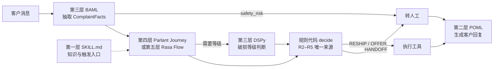

# 客服 Skill 五层语义化编程示例

场景：海外客户反馈“大件户外家具到货破损或缺件”。
同一组业务规则、同一组测试用例，在五层方案里分别实现，用来对比每层适合承担什么。

> 说明：业务规则、金额阈值、SKU 和配件号均为示意数据，不代表实际售后政策。代码按各项目公开文档语法编写，未在真实环境运行，落地前需按所用版本校验。

---

## 0. 统一场景定义

### 0.1 示意业务规则

| 编号 | 规则 | 性质 |
|---|---|---|
| R1 | 必须拿到订单号；破损必须有照片，缺件必须有配件编号或说明书页码 | 信息收集 |
| R2 | 签收超过 30 天，不自动处理，转人工 | 硬规则 |
| R3 | 缺件且配件有库存 → 补寄配件；无库存 → 转人工 | 硬规则 |
| R4 | 外观轻微破损（划痕、凹痕，不影响使用）→ 客户可选“补寄部件”或“部分退款 15%” | 硬规则 + 语义判断 |
| R5 | 结构性破损（断裂、无法组装、承重件变形）→ 换新或全额退款；订单金额 > 300 USD 需人工审批 | 硬规则 + 语义判断 |
| R6 | 涉及受伤、安全隐患、律师、媒体曝光 → 立即转人工，不讨论赔偿 | 安全规则 |
| R7 | 未经系统确认，不承诺任何退款金额或时效 | 话术约束 |
| R8 | 回复使用客户语言，语气专业克制，先确认问题再给方案 | 话术约束 |

### 0.2 统一数据契约

所有层都围绕同一个结构：

```text
ComplaintFacts
  order_id            string | null
  issue_type          DAMAGED | MISSING_PARTS | OTHER
  severity            COSMETIC | STRUCTURAL | UNKNOWN      # 仅破损时有意义
  missing_part_codes  string[]
  has_photos          bool
  safety_risk         bool                                 # 受伤/安全/律师/媒体
  preferred_resolution PARTS | PARTIAL_REFUND | REPLACEMENT | REFUND | NONE
```

### 0.3 统一测试用例

| 用例 | 客户消息（示意） | 期望结果 |
|---|---|---|
| T1 | "Order #AS-10023. The swing chair arrived but part C4 is missing." | 缺件，C4 有库存 → 补寄 |
| T2 | "Order #AS-10088, the table top has a few scratches." + 照片 | 轻微破损 → 给出补件/15% 两个选项 |
| T3 | "Order #AS-10101, the frame leg snapped while assembling." + 照片，订单 459 USD | 结构性破损 + 金额 > 300 → 转人工审批 |
| T4 | "The bench collapsed and my son got hurt. I'm contacting a lawyer." | 安全风险 → 立即转人工，不谈赔偿 |
| T5 | "My order is damaged."（无订单号、无照片） | 追问订单号和照片，不给方案 |
| T6 | "Order #AS-09001, received 45 days ago, a part is missing." | 超 30 天 → 转人工 |

---

## 1. 第一层：Agent Skills（SKILL.md）

定位：告诉通用 Agent “什么时候用、怎么做”，硬规则下沉到脚本。

### 目录结构

```text
damaged-or-missing-parts/
├── SKILL.md
├── references/
│   ├── policy.md            # R1–R8 的完整政策文本
│   └── reply-templates.md   # 各结论的回复范式
└── scripts/
    └── decide.py            # 确定性规则判定
```

### SKILL.md

```markdown
---
name: damaged-or-missing-parts
description: 处理客户反馈的大件家具到货破损或缺件售后。当客户提到 damaged、broken、scratched、missing part、缺件、破损、无法组装时使用。不用于物流延误、退货运费争议或产品使用咨询。
metadata:
  owner: cs-platform
  policy-version: "2026-11-demo"
---

# 到货破损/缺件处理

## 第一步：安全优先
如果客户提到受伤、安全隐患、律师、媒体曝光：
立即调用 transfer_to_human(reason="safety")，用一句话致歉并说明专人会跟进。
不讨论原因、责任和赔偿。停止后续步骤。

## 第二步：收集必要信息
必须拿到：
- 订单号
- 破损：至少一张照片
- 缺件：配件编号（说明书上的字母+数字，如 C4）或说明书页码

缺什么只追问什么，一次最多问两项。

## 第三步：调用规则脚本
信息齐全后运行：
python scripts/decide.py --order-id <ID> --issue <DAMAGED|MISSING_PARTS> \
  --severity <COSMETIC|STRUCTURAL|UNKNOWN> --parts <C4,C5>

severity 由你根据照片和描述判断：
- COSMETIC：划痕、轻微凹痕、色差，不影响组装和承重
- STRUCTURAL：断裂、开裂、变形、孔位错误导致无法组装
- 拿不准时填 UNKNOWN，脚本会转人工

## 第四步：按脚本结论回复
只能使用脚本返回的 decision 和 options，不自行增加方案。
回复范式见 references/reply-templates.md。

## 禁止事项
- 不承诺脚本未返回的退款金额或到账时间
- 不说“这是物流公司的责任”
- 不要求客户退回大件实物，除非脚本结论要求
```

### scripts/decide.py

```python
"""到货破损/缺件的确定性判定。示意实现，数据源用桩函数代替。"""
import argparse, json
from datetime import date

def get_order(order_id: str) -> dict:
    # 实际应调用 OMS
    demo = {
        "AS-10023": {"amount_usd": 189, "delivered": "2026-11-01"},
        "AS-10088": {"amount_usd": 129, "delivered": "2026-11-03"},
        "AS-10101": {"amount_usd": 459, "delivered": "2026-11-05"},
        "AS-09001": {"amount_usd": 220, "delivered": "2026-09-25"},
    }
    return demo[order_id]

def part_in_stock(code: str) -> bool:
    return code in {"C4", "C5", "B2"}   # 实际应调用配件库存

def decide(order_id, issue, severity, parts, today=date(2026, 11, 9)):
    order = get_order(order_id)
    days = (today - date.fromisoformat(order["delivered"])).days

    if days > 30:                                            # R2
        return {"decision": "HANDOFF", "reason": "over_30_days"}

    if issue == "MISSING_PARTS":                             # R3
        missing = [p for p in parts if not part_in_stock(p)]
        if missing:
            return {"decision": "HANDOFF", "reason": "part_out_of_stock", "parts": missing}
        return {"decision": "RESHIP_PARTS", "parts": parts}

    if issue == "DAMAGED":
        if severity == "COSMETIC":                           # R4
            return {"decision": "OFFER", "options": ["RESHIP_PARTS", "PARTIAL_REFUND_15"]}
        if severity == "STRUCTURAL":                         # R5
            if order["amount_usd"] > 300:
                return {"decision": "HANDOFF", "reason": "needs_approval"}
            return {"decision": "OFFER", "options": ["REPLACEMENT", "FULL_REFUND"]}

    return {"decision": "HANDOFF", "reason": "unclear"}

if __name__ == "__main__":
    ap = argparse.ArgumentParser()
    ap.add_argument("--order-id", required=True)
    ap.add_argument("--issue", required=True)
    ap.add_argument("--severity", default="UNKNOWN")
    ap.add_argument("--parts", default="")
    a = ap.parse_args()
    parts = [p for p in a.parts.split(",") if p]
    print(json.dumps(decide(a.order_id, a.issue, a.severity, parts), ensure_ascii=False))
```

这一层的特点：
- 触发、步骤、话术约束都是自然语言，人人能改。
- R2/R3/R4/R5 已经下沉到脚本，模型只负责“判断 severity”和“组织回复”。
- 弱点：第一步安全拦截、第二步信息收集仍依赖模型自觉遵守，没有运行时强制。

---

## 2. 第二层：POML（结构化提示）

定位：把“生成客户回复”这一步的提示写成可维护的结构化模板。规则判定结果作为输入传入，模板只管怎么说。

### reply.poml

```xml
<poml>
  <role>
    你是跨境家具品牌的售后客服。语气专业、克制、有同理心。
    使用客户的语言回复（客户语言：{{ customer_language }}）。
  </role>

  <task>
    根据“系统判定结果”给客户写一条回复。
    先用一句话确认客户遇到的问题，再给出方案，最后说明下一步。
    只能使用判定结果中的方案，不得增加、改写或承诺金额与时效。
  </task>

  <cp caption="客户原始消息">
    <text>{{ customer_message }}</text>
  </cp>

  <cp caption="系统判定结果">
    <text>decision: {{ decision }}</text>
    <list if="options">
      <item for="opt in options">{{ opt }}</item>
    </list>
    <text if="reason">reason: {{ reason }}</text>
  </cp>

  <cp caption="各结论的写法">
    <list>
      <item>RESHIP_PARTS：确认补寄的配件编号，说明会另行发送物流单号。</item>
      <item>OFFER：并列列出选项，请客户回复选择，不替客户做决定。</item>
      <item>HANDOFF：说明已转交专人处理，不解释内部原因，不给方案。</item>
      <item>reason 为 safety 时：只致歉并说明专人会尽快联系，不提责任、原因、赔偿。</item>
    </list>
  </cp>

  <example>
    <input>decision: OFFER；options: RESHIP_PARTS, PARTIAL_REFUND_15；客户说桌面有划痕</input>
    <output>
      Sorry to hear the table top arrived with scratches. We can either send you a
      replacement table top, or offer a 15% partial refund if you'd prefer to keep it
      as is. Just reply with the option that works best for you.
    </output>
  </example>

  <output-format>
    纯文本，不超过 80 个英文单词或 150 个汉字。不使用列表符号以外的格式。
  </output-format>
</poml>
```

### 调用方式（Python）

```python
import poml

messages = poml.poml(
    "reply.poml",
    context={
        "customer_language": "English",
        "customer_message": "Order #AS-10088, the table top has a few scratches.",
        "decision": "OFFER",
        "options": ["RESHIP_PARTS", "PARTIAL_REFUND_15"],
        "reason": None,
    },
    format="openai_chat",
)
# 把 messages 交给任意 Chat Completion 接口
```

这一层的特点：
- 角色、任务、示例、输出格式分区清楚，话术团队可以只改 `<cp>` 和 `<example>`。
- 条件渲染（`if` / `for`）避免手写字符串拼接。
- 不负责判定，只负责表达；R7、R8 在这里落地。

---

## 3. 第三层：类型化语义函数（BAML + DSPy）

定位：把“语义判断”写成有类型输入输出的函数，可测试、可优化。
这里分工：BAML 负责从消息里抽取 `ComplaintFacts`；DSPy 负责根据描述和照片判断破损等级，并用标注样本自动优化。

### 3A. BAML：事实抽取

```baml
// complaint.baml

enum IssueType {
  DAMAGED       @description("商品到货有破损、划痕、断裂、变形")
  MISSING_PARTS @description("包装内缺少配件、螺丝、部件")
  OTHER         @description("与破损缺件无关的问题")
}

enum Resolution {
  PARTS
  PARTIAL_REFUND
  REPLACEMENT
  REFUND
  NONE @description("客户没有表达偏好")
}

class ComplaintFacts {
  order_id string? @description("订单号，形如 AS-12345；消息中没有则为 null")
  issue_type IssueType
  missing_part_codes string[] @description("说明书上的配件编号，如 C4、B2")
  has_photos bool
  safety_risk bool @description("提到受伤、安全隐患、律师、起诉、媒体曝光时为 true")
  preferred_resolution Resolution
}

function ExtractComplaint(message: string, photos: image[]) -> ComplaintFacts {
  client "openai/gpt-4o-mini"
  prompt #"
    {{ _.role("system") }}
    你从售后消息中抽取结构化事实。只抽取客户明确说出的信息，不推测。

    {{ _.role("user") }}
    客户消息：
    {{ message }}

    附带照片数量：{{ photos | length }}

    {{ ctx.output_format }}
  "#
}

test t1_missing_part {
  functions [ExtractComplaint]
  args {
    message "Order #AS-10023. The swing chair arrived but part C4 is missing."
    photos []
  }
  @@assert({{ this.issue_type == "MISSING_PARTS" }})
  @@assert({{ this.missing_part_codes | length == 1 }})
  @@assert({{ this.safety_risk == false }})
}

test t4_safety {
  functions [ExtractComplaint]
  args {
    message "The bench collapsed and my son got hurt. I'm contacting a lawyer."
    photos []
  }
  @@assert({{ this.safety_risk == true }})
  @@assert({{ this.order_id == null }})
}

test t5_missing_info {
  functions [ExtractComplaint]
  args {
    message "My order is damaged."
    photos []
  }
  @@assert({{ this.order_id == null }})
  @@assert({{ this.has_photos == false }})
}
```

生成客户端后，在业务代码里像普通函数一样调用：

```python
from baml_client import b

facts = b.ExtractComplaint(message=msg, photos=[])
if facts.safety_risk:
    transfer_to_human(reason="safety")
```

### 3B. DSPy：破损等级判断与优化

```python
import dspy
from typing import Literal

dspy.configure(lm=dspy.LM("openai/gpt-4o-mini"))

class AssessDamage(dspy.Signature):
    """判断大件家具到货破损的严重程度。
    COSMETIC：划痕、轻微凹痕、色差，不影响组装与承重。
    STRUCTURAL：断裂、开裂、变形、孔位错误导致无法组装或影响承重。
    证据不足时输出 UNKNOWN。"""

    description: str = dspy.InputField(desc="客户对破损的文字描述")
    photo: dspy.Image = dspy.InputField(desc="破损照片")
    product_type: str = dspy.InputField(desc="商品类型，如 swing chair、patio table")
    severity: Literal["COSMETIC", "STRUCTURAL", "UNKNOWN"] = dspy.OutputField()
    evidence: str = dspy.OutputField(desc="一句话说明依据，供人工复核")

assess = dspy.ChainOfThought(AssessDamage)

# 历史工单中已由人工确认等级的样本（示意）
trainset = [
    dspy.Example(
        description="the table top has a few scratches",
        photo=dspy.Image("cases/10088.jpg"),
        product_type="patio table",
        severity="COSMETIC",
    ).with_inputs("description", "photo", "product_type"),
    dspy.Example(
        description="the frame leg snapped while assembling",
        photo=dspy.Image("cases/10101.jpg"),
        product_type="swing chair",
        severity="STRUCTURAL",
    ).with_inputs("description", "photo", "product_type"),
    # ... 实际需要几十到几百条
]

def severity_metric(example, pred, trace=None):
    # 把结构性破损误判为轻微，比反过来代价更高
    if example.severity == "STRUCTURAL" and pred.severity == "COSMETIC":
        return 0.0
    if pred.severity == "UNKNOWN":
        return 0.5          # 转人工可接受，但不是最优
    return float(pred.severity == example.severity)

optimizer = dspy.MIPROv2(metric=severity_metric, auto="light")
optimized_assess = optimizer.compile(assess, trainset=trainset)
optimized_assess.save("assess_damage_v1.json")
```

这一层的特点：
- BAML：抽取结果是强类型对象，`@@assert` 测试可以进 CI；改提示后马上能看出哪些用例坏了。
- DSPy：只声明“输入什么、输出什么、怎么算对”，提示由优化器从历史工单学出来；指标里直接写清楚“哪种误判代价更高”。
- 两者都不决定业务结论，只产出 R1、R4、R5、R6 需要的事实。

---

## 4. 第四层：Parlant（条件—动作规则 + 自适应 SOP）

定位：管理多轮对话。Journey 描述正常流程，Guideline 描述任何时刻都要生效的行为规则，工具负责查询和执行。

```python
import asyncio
import parlant.sdk as p

# ---------- 工具：所有硬判断都在工具里 ----------

@p.tool
async def lookup_order(context: p.ToolContext, order_id: str) -> p.ToolResult:
    """查询订单金额与签收天数。"""
    order = await oms.get(order_id)                       # 示意
    return p.ToolResult(data={
        "amount_usd": order.amount_usd,
        "days_since_delivery": order.days_since_delivery,
    })

@p.tool
async def check_parts_stock(context: p.ToolContext, part_codes: list[str]) -> p.ToolResult:
    """查询配件库存。"""
    result = await parts_inventory.check(part_codes)      # 示意
    return p.ToolResult(data=result)

@p.tool
async def decide_resolution(
    context: p.ToolContext,
    order_id: str,
    issue_type: str,
    severity: str,
    part_codes: list[str],
) -> p.ToolResult:
    """调用规则服务（即第一层的 decide 逻辑），返回唯一允许的方案。"""
    return p.ToolResult(data=rules.decide(order_id, issue_type, severity, part_codes))

@p.tool
async def create_parts_reshipment(
    context: p.ToolContext, order_id: str, part_codes: list[str]
) -> p.ToolResult:
    ticket = await aftersales.reship(order_id, part_codes)  # 示意
    return p.ToolResult(data={"ticket_id": ticket.id})

@p.tool
async def transfer_to_human(context: p.ToolContext, reason: str) -> p.ToolResult:
    await handoff.create(context.session_id, reason)        # 示意
    return p.ToolResult(data={"transferred": True})


# ---------- Journey：正常流程 ----------

async def create_damage_journey(agent: p.Agent) -> p.Journey:
    journey = await agent.create_journey(
        title="到货破损或缺件",
        conditions=["客户反馈收到的商品破损、有划痕、断裂，或缺少配件"],
        description="收集订单与证据，调用规则服务得出方案，并执行或转人工。",
    )

    t1 = await journey.initial_state.transition_to(
        chat_state="确认客户遇到的问题，并请客户提供订单号",
    )
    t2 = await t1.target.transition_to(tool_state=lookup_order, condition="客户提供了订单号")

    fork = await t2.target.fork()

    # 超过 30 天：R2
    late = await fork.target.transition_to(
        tool_state=transfer_to_human,
        condition="签收超过 30 天",
        tool_instruction="reason 填 over_30_days",
    )
    late_msg = await late.target.transition_to(chat_state="说明已转交专人处理")
    await late_msg.target.transition_to(state=p.END_JOURNEY)

    # 缺件分支
    mp = await fork.target.transition_to(
        chat_state="请客户提供说明书上的缺失配件编号，例如 C4",
        condition="签收 30 天内，且客户反馈缺件",
    )
    # 破损分支
    dmg = await fork.target.transition_to(
        chat_state="请客户上传破损部位的照片",
        condition="签收 30 天内，且客户反馈破损",
    )

    decide_mp = await mp.target.transition_to(
        tool_state=decide_resolution, condition="客户提供了配件编号",
    )
    decide_dmg = await dmg.target.transition_to(
        tool_state=decide_resolution,
        condition="客户上传了照片",
        tool_instruction="severity 使用破损等级判断服务的结果；拿不准填 UNKNOWN",
    )

    # 两条分支在结论处汇合
    present = await decide_mp.target.transition_to(
        chat_state="按规则服务返回的结论向客户说明方案；有多个选项时请客户选择",
    )
    await decide_dmg.target.transition_to(state=present.target)

    reship = await present.target.transition_to(
        tool_state=create_parts_reshipment,
        condition="结论是补寄配件，或客户选择了补寄配件",
    )
    done = await reship.target.transition_to(chat_state="告知补寄工单号，物流单号会另行发送")
    await done.target.transition_to(state=p.END_JOURNEY)

    handoff_t = await present.target.transition_to(
        tool_state=transfer_to_human, condition="结论是转人工",
    )
    await handoff_t.target.transition_to(state=p.END_JOURNEY)

    # 只在本 Journey 内生效的规则
    await journey.create_guideline(
        condition="客户要求的方案不在规则服务返回的选项中",
        action="礼貌说明当前可提供的选项，不自行增加方案；客户坚持时转人工",
        tools=[transfer_to_human],
    )
    return journey


# ---------- 全局 Guideline：任何时刻都生效 ----------

async def create_global_guidelines(agent: p.Agent) -> None:
    await agent.create_guideline(                               # R6
        condition="客户提到受伤、安全隐患、律师、起诉或媒体曝光",
        action="立即转人工，只致歉并说明专人会尽快联系，不讨论原因、责任或赔偿",
        tools=[transfer_to_human],
    )
    await agent.create_guideline(                               # R7
        condition="客户询问退款金额或到账时间，而规则服务尚未返回结论",
        action="说明需要先核实订单和证据，不给出任何金额或时效",
    )
    await agent.create_guideline(                               # R8
        condition="客户使用非英语交流",
        action="使用客户的语言回复",
    )


async def main() -> None:
    async with p.Server() as server:
        agent = await server.create_agent(
            name="AfterSales",
            description="跨境家具品牌售后客服，专业克制，先确认问题再给方案。",
        )
        await create_global_guidelines(agent)
        await create_damage_journey(agent)

asyncio.run(main())
```

这一层的特点：
- R6 写成全局 Guideline，客户在流程任何位置提到受伤都会触发，不依赖模型“记得第一步”。
- Journey 是自适应的：客户第一句话就给了订单号和照片，可以直接跳过追问状态。
- 业务结论仍来自 `decide_resolution`，Parlant 只管“什么时候说什么、调什么”。

---

## 5. 第五层：Rasa CALM（声明式流程 + 确定性执行）

定位：流程每一步由引擎确定性推进，LLM 只负责理解客户意图、填写槽位。适合退款、补寄这种必须可审计的动作。

### flows.yml

```yaml
flows:
  report_damage_or_missing_parts:
    description: 客户反馈收到的家具破损、有划痕、断裂或缺少配件，需要售后处理
    steps:
      - collect: safety_risk
        ask_before_filling: false          # 只从客户原话中提取，不主动询问
        next:
          - if: slots.safety_risk
            then:
              - action: action_handoff_to_human
              - action: utter_safety_handoff
                next: END
          - else: ask_order

      - id: ask_order
        collect: order_id
        description: 订单号，形如 AS-12345
      - action: action_lookup_order        # 写入 days_since_delivery、amount_usd
        next:
          - if: slots.days_since_delivery > 30
            then:
              - action: action_handoff_to_human
              - action: utter_handoff_generic
                next: END
          - else: ask_issue

      - id: ask_issue
        collect: issue_type
        description: 问题类型，damaged 或 missing_parts
        next:
          - if: slots.issue_type = "missing_parts"
            then: ask_parts
          - else: ask_photos

      - id: ask_parts
        collect: missing_part_codes
        description: 说明书上缺失配件的编号，如 C4，多个用逗号分隔
        next: decide

      - id: ask_photos
        collect: photos_uploaded
        next:
          - if: slots.photos_uploaded
            then:
              - action: action_assess_damage   # 调用第三层的 DSPy 判定，写入 severity
                next: decide
          - else: ask_photos

      - id: decide
        action: action_decide_resolution       # 写入 decision、options
        next:
          - if: slots.decision = "RESHIP_PARTS"
            then:
              - action: action_create_parts_reshipment
              - action: utter_parts_reshipped
                next: END
          - if: slots.decision = "OFFER"
            then: ask_choice
          - else:
              - action: action_handoff_to_human
              - action: utter_handoff_generic
                next: END

      - id: ask_choice
        collect: chosen_option
        description: 客户从系统给出的选项中选择的方案
      - action: action_execute_choice
      - action: utter_choice_confirmed
```

### domain.yml（节选）

```yaml
slots:
  safety_risk:
    type: bool
    initial_value: false
    mappings:
      - type: from_llm
  order_id:
    type: text
    mappings:
      - type: from_llm
  issue_type:
    type: categorical
    values: [damaged, missing_parts]
    mappings:
      - type: from_llm
  missing_part_codes:
    type: text
    mappings:
      - type: from_llm
  photos_uploaded:
    type: bool
    mappings:
      - type: from_llm
  days_since_delivery:
    type: float
    mappings:
      - type: controlled
  amount_usd:
    type: float
    mappings:
      - type: controlled
  severity:
    type: categorical
    values: [COSMETIC, STRUCTURAL, UNKNOWN]
    mappings:
      - type: controlled
  decision:
    type: categorical
    values: [RESHIP_PARTS, OFFER, HANDOFF]
    mappings:
      - type: controlled
  options:
    type: list
    mappings:
      - type: controlled
  chosen_option:
    type: categorical
    values: [RESHIP_PARTS, PARTIAL_REFUND_15, REPLACEMENT, FULL_REFUND]
    mappings:
      - type: from_llm

responses:
  utter_ask_order_id:
    - text: "Sorry to hear that. Could you share your order number? It looks like AS-12345."
  utter_ask_missing_part_codes:
    - text: "Which part is missing? The part code is printed in the manual, for example C4."
  utter_ask_photos_uploaded:
    - text: "Could you upload a photo of the damaged area so we can find the best solution?"
  utter_ask_chosen_option:
    - text: "Here are the options we can offer: {options}. Which one works best for you?"
  utter_safety_handoff:
    - text: "We're very sorry. A specialist will contact you as soon as possible."
  utter_handoff_generic:
    - text: "Thanks for the details. I've passed this to a specialist who will follow up with you."
  utter_parts_reshipped:
    - text: "We'll send the replacement part(s) right away. You'll receive a tracking number by email."
  utter_choice_confirmed:
    - text: "Thanks, your request has been submitted. We'll email you the next steps."

actions:
  - action_lookup_order
  - action_assess_damage
  - action_decide_resolution
  - action_create_parts_reshipment
  - action_execute_choice
  - action_handoff_to_human
```

### actions.py（节选）

```python
from rasa_sdk import Action, Tracker
from rasa_sdk.executor import CollectingDispatcher
from rasa_sdk.events import SlotSet

from rules import decide            # 与第一层 decide.py 同一份规则代码

class ActionLookupOrder(Action):
    def name(self) -> str:
        return "action_lookup_order"

    async def run(self, dispatcher: CollectingDispatcher, tracker: Tracker, domain):
        order = await oms.get(tracker.get_slot("order_id"))          # 示意
        return [
            SlotSet("days_since_delivery", order.days_since_delivery),
            SlotSet("amount_usd", order.amount_usd),
        ]

class ActionDecideResolution(Action):
    def name(self) -> str:
        return "action_decide_resolution"

    async def run(self, dispatcher: CollectingDispatcher, tracker: Tracker, domain):
        issue = "MISSING_PARTS" if tracker.get_slot("issue_type") == "missing_parts" else "DAMAGED"
        parts = [p.strip() for p in (tracker.get_slot("missing_part_codes") or "").split(",") if p.strip()]
        result = decide(
            tracker.get_slot("order_id"),
            issue,
            tracker.get_slot("severity") or "UNKNOWN",
            parts,
        )
        return [
            SlotSet("decision", result["decision"]),
            SlotSet("options", result.get("options", [])),
        ]
```

这一层的特点：
- 客户说什么都不能让流程跳过 `action_decide_resolution`，退款和补寄只会在规则返回对应结论后执行。
- `controlled` 槽位（金额、天数、结论）只能由代码写入，LLM 改不了。
- 代价是灵活性低：客户中途改口、一次说多件事，需要靠 Rasa 的对话修复模式处理，流程设计成本更高。

---

## 6. 六个用例在各层的表现

| 用例 | 第一层 SKILL.md | 第二层 POML | 第三层 BAML/DSPy | 第四层 Parlant | 第五层 Rasa |
|---|---|---|---|---|---|
| T1 缺件有库存 | 模型调脚本 → 补寄 | 只写补寄话术 | BAML 抽出 C4 | Journey 走缺件分支 | 流程走 ask_parts → 补寄 |
| T2 轻微划痕 | 模型判 COSMETIC → 两个选项 | 并列两个选项 | DSPy 判 COSMETIC | 呈现选项并等待选择 | ask_choice 收集选择 |
| T3 结构破损 > 300 | 脚本返回 HANDOFF | 写转人工话术 | DSPy 判 STRUCTURAL | 转人工 | 转人工 |
| T4 受伤+律师 | 依赖模型遵守第一步 | reason=safety 专用写法 | BAML safety_risk=true | 全局 Guideline 任何时刻拦截 | 第一步硬拦截 |
| T5 信息不全 | 依赖模型追问 | 不涉及 | order_id=null 可断言 | 停在追问状态 | collect 强制追问 |
| T6 超 30 天 | 脚本返回 HANDOFF | 写转人工话术 | 不涉及 | fork 走超期分支 | 条件分支转人工 |

关键差异集中在 T4 和 T5：越往下层，“必须做”的事越由运行时保证，而不是靠模型自觉。

---

## 7. 规则归属：谁是唯一事实来源

| 规则 | 建议归属 | 理由 |
|---|---|---|
| R1 信息收集 | 第四层或第五层 | 需要运行时保证“没拿到就不往下走” |
| R2 30 天 | 规则代码（decide） | 纯计算，不应由模型判断 |
| R3 配件库存 | 规则代码 + 库存工具 | 依赖实时数据 |
| R4/R5 等级判断 | 第三层 DSPy | 唯一真正需要语义判断的地方，需要标注样本和指标 |
| R4/R5 方案与审批阈值 | 规则代码 | 金额阈值必须可审计 |
| R6 安全拦截 | 第三层抽取 + 第四层全局 Guideline，或第五层首步 | 双保险：抽取识别，运行时拦截 |
| R7 不承诺金额 | 第二层模板 + 第四层 Guideline | 话术约束 |
| R8 语气与语言 | 第二层模板 | 话术团队维护 |

同一条规则只在一处定义。例如 R2–R5 只写在 `decide`，SKILL.md、Parlant、Rasa 都调用它，而不是各写一遍。

---

## 8. 推荐组合



- 对话编排二选一：容忍一定灵活性选 Parlant；资金动作要求严格可审计选 Rasa。也可以混用，咨询类走 Parlant，退款补寄走 Rasa。
- 第一层 SKILL.md 适合作为内部 Agent（如坐席助手、AI coding）的知识入口，不直接承担面向客户的生产对话。
- 第三层是唯一需要持续优化的地方：用人工复核过的历史工单做训练集，指标里写清楚误判代价。

## 9. 参考资料

- Agent Skills 规范：https://agentskills.io/specification
- POML：https://github.com/microsoft/poml
- BAML：https://docs.boundaryml.com/guide/baml-basics/prompting-with-baml
- DSPy Signatures：https://dspy.ai/learn/programming/signatures/
- Parlant Journeys：https://www.parlant.io/docs/concepts/customization/journeys/
- Rasa Flows：https://rasa.com/docs/reference/primitives/flows
